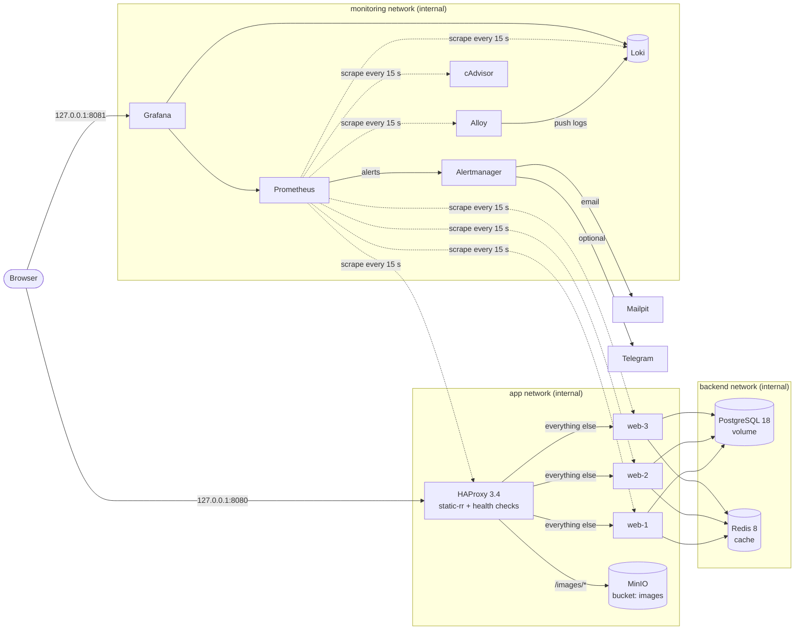
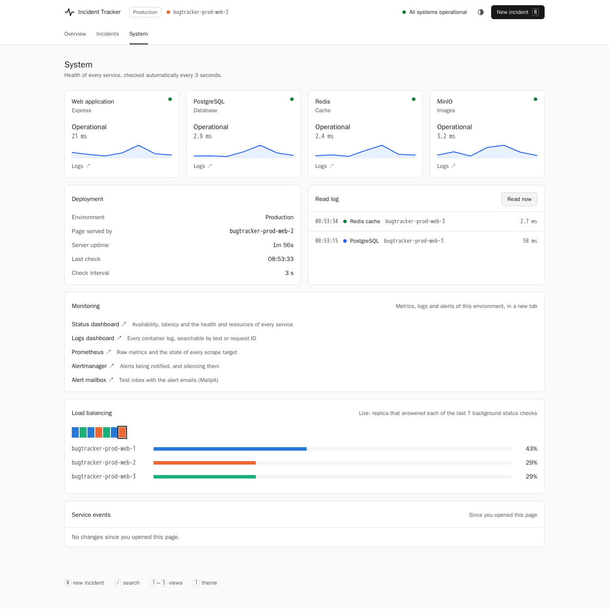
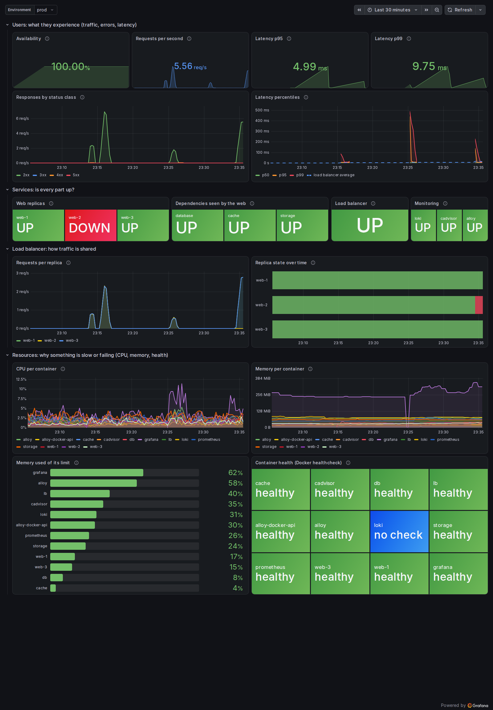
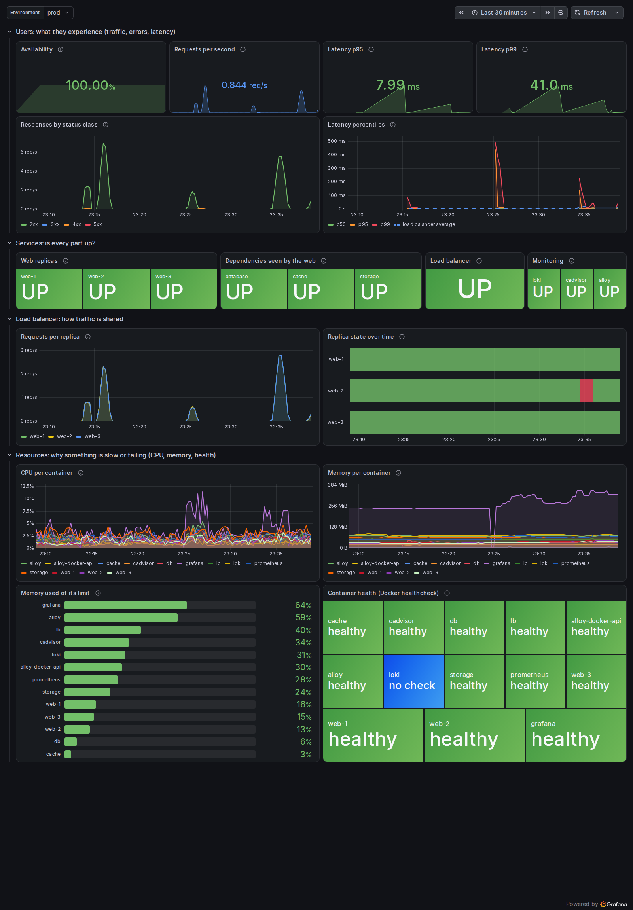
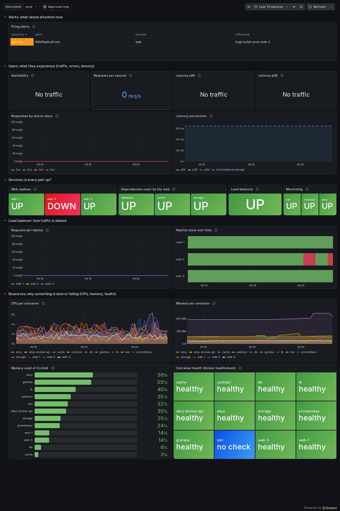
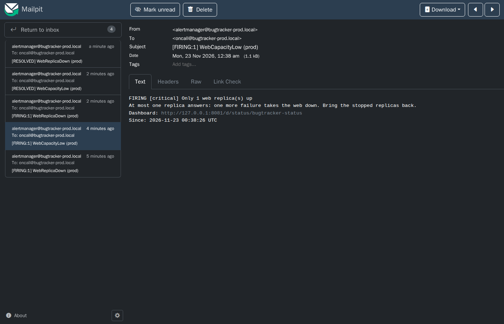
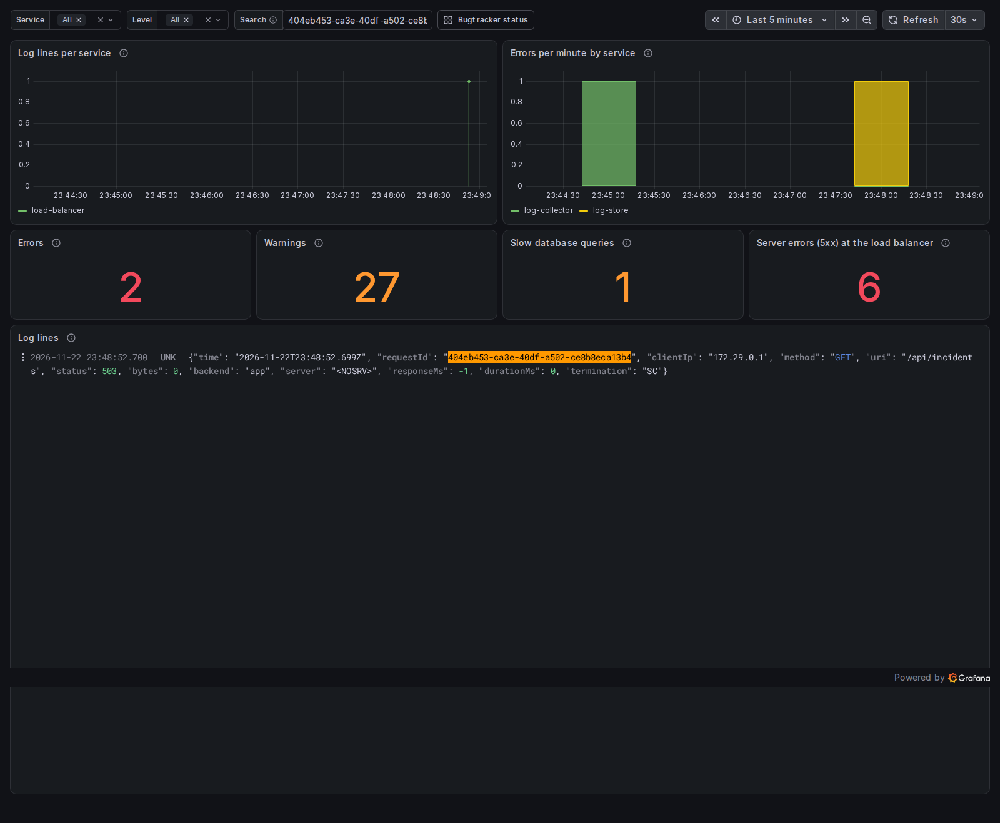

# IT Incident Tracker — Infrastructure as Code with Terraform

<p align="left">
  
  
  
  
  
  
  
  
  
</p>

A complete, production-style infrastructure for an IT incident tracker (Node.js, PostgreSQL, Redis), written as
code with **Terraform** and run on Docker as a local cloud. One command brings up a development and a production
environment side by side: a load balancer in front of replicated web servers, S3-compatible object storage, and
observability with metrics, centralized logs, dashboards and alerts that reach email and Telegram. Every module is
reusable, every container is hardened, and an end-to-end suite of 72 checks proves it all works.

---

## 1. Overview & Architecture

Each environment is a separate Terraform root (`environments/dev`, `environments/prod`) built from the same
reusable modules (`modules/`). Every resource name starts with `bugtracker-<environment>`, so both run at once.

### System architecture (prod; dev is the same with 2 replicas, no cache and no alerting)



### Request flow
- **Images:** the browser asks the load balancer for `/images/*`, which it serves straight from the MinIO bucket,
  like a CDN in front of S3. The web replicas never touch them; CSS and JavaScript ship with the code.
- **Everything else** goes to the web replicas with HAProxy's `static-rr` policy. Every request gets a request ID
  (`X-Request-ID`, a UUID) that appears in the load balancer log, in the replica log and in the response.
- **Cache-aside (prod):** `GET /api/incidents` reads Redis first (`X-Cache: HIT`); on a miss it queries
  PostgreSQL and caches the result for 60 s. A `POST` invalidates it. If Redis fails, reads fall back to
  PostgreSQL and `/status` reports `degraded`.

The page shows **which replica served it** (header badge and the *System* view):



---

## 2. Environment Comparison

All settings live in each environment's `terraform.tfvars` (versioned, no secrets).

| Parameter | Development (`dev`) | Production (`prod`) |
| :--- | :--- | :--- |
| **Web replicas** | 2 | 3 |
| **App URL** | `127.0.0.1:3000` | `127.0.0.1:8080` |
| **Cache (Redis)** | Disabled | Enabled (64 MB, LRU eviction) |
| **Monitoring** | Prometheus, Loki, Grafana (`:3001`) | Same, Grafana on `:8081` |
| **Alerts** | Rules evaluated, nobody notified | Alertmanager → email (Mailpit `:8025`) + Telegram |
| **Admin tools published** | MinIO console `:9001`, Prometheus `:9090` | Alertmanager `:9093` only |
| **Restart policy** | Docker default (none) | `unless-stopped` on every container |
| **Memory limits** | None | Every container (measured usage + margin) |
| **Log level of the app** | `debug` (one line per request) | `info` |

---

## 3. Quick Start

### Prerequisites
- Docker Engine (tested with 29.10) and **Terraform ≥ 1.9** (tested with 1.9.0 and 1.17)
- `make`, `curl`, `bash`; `python3` for the test suite

### Deploy and open
```bash
# Plan and apply both environments (each one: plan -out=tfplan, then apply tfplan)
make up-all

# Every URL and user of both environments (no secrets on screen)
make urls

# The generated passwords (Grafana, MinIO console), only when asked for
make passwords
```

| | dev | prod |
| :--- | :--- | :--- |
| Application | http://127.0.0.1:3000 | http://127.0.0.1:8080 |
| Grafana (user `admin`) | http://127.0.0.1:3001 | http://127.0.0.1:8081 |
| Prometheus / Alertmanager | http://127.0.0.1:9090 | http://127.0.0.1:9093 |
| MinIO console / alert mailbox | http://127.0.0.1:9001 | http://127.0.0.1:8025 |

### Telegram alerts (optional)
Copy `environments/prod/secrets.auto.tfvars.example` to `secrets.auto.tfvars` (ignored by git) and fill in a
bot token from @BotFather and your chat ID, then `make up ENV=prod`. Without it, alerts are only emailed.

### Stop or destroy
```bash
make stop ENV=prod      # stop the containers, keep the data
make start ENV=prod     # start them again
make destroy ENV=prod   # delete everything of prod, data volumes included
```

---

## 4. Project Structure

```
app/                     Express 5 web application (Dockerfile, /metrics on port 9464)
images/                  Priority pictures uploaded to the MinIO bucket and served by the load balancer
db/init.sql              Schema + 50,006 seed incidents
modules/                 Reusable Terraform modules (one per component, no project names inside)
environments/dev|prod    One Terraform root per environment: main.tf, variables.tf, terraform.tfvars, outputs.tf
monitoring/dashboards    Grafana dashboards as code (provisioned, not editable from the UI)
monitoring/alerts        Prometheus alerting rules + their promtool unit tests
scripts/test.sh          End-to-end verification (make test)
scripts/demo.sh          Guided demonstration (make demo)
Makefile                 Every operation, for ENV=dev|prod
```

### Modules

| Module | Runs | Notes |
| :--- | :--- | :--- |
| [`web`](modules/web/README.md) | N replicas of the app | Image built from the code, tagged with its hash; optional `metrics_port` |
| [`database`](modules/database/README.md) | PostgreSQL 18 | Generated password, named volume, init script, slow query log (`slow_query_ms`) |
| [`cache`](modules/cache/README.md) | Redis 8 | Pure cache: no persistence, `maxmemory` + LRU, generated password |
| [`load-balancer`](modules/load-balancer/README.md) | HAProxy 3.4 | Health checks, path routes, request ID, JSON access log, metrics port |
| [`object-storage`](modules/object-storage/README.md) | MinIO + init script | Creates the bucket, download-only policy, syncs a folder when it changes |
| [`log-store`](modules/log-store/README.md) | Loki | 7-day retention, no usage reports |
| [`log-collector`](modules/log-collector/README.md) | Alloy + Docker API proxy | Collects only the containers with given labels, through a read-only API proxy |
| [`container-metrics`](modules/container-metrics/README.md) | cAdvisor | CPU, memory, network and Docker health of every container, no privileged mode |
| [`metrics-store`](modules/metrics-store/README.md) | Prometheus | Scrape jobs, label filters, alerting rules, Alertmanager targets |
| [`dashboards`](modules/dashboards/README.md) | Grafana | Provisioned data sources and dashboards, generated admin password |
| [`alert-manager`](modules/alert-manager/README.md) | Alertmanager | Grouping, inhibition, email and Telegram receivers, links to Grafana |
| [`mail-catcher`](modules/mail-catcher/README.md) | Mailpit | Test SMTP server with a web UI |

Every module takes `restart`, `memory` and `labels` as optional inputs (null keeps Docker's default), pins its image,
uses the rotating `local` log driver and passes data to others through outputs. **Each module has its own README**
with a usage example, notes and its inputs and outputs (e.g. [modules/load-balancer](modules/load-balancer/README.md));
the tables are generated from the code with [terraform-docs](https://terraform-docs.io/) (`make docs`).

---

## 5. Load Balancing & High Availability

- **Policy: `static-rr`** (static round-robin). Requests are short and similar, so strict turns spread them evenly;
  measured: `static-rr` alternates exactly, while `roundrobin` gave 13/7 on 20 requests, and it puts a recovered
  replica back in rotation at once. `leastconn` only pays off with long connections.
- **Active health checks** on `/live` every 2 s (HTTP/1.1): a replica that stops answering leaves the rotation
  before users hit it. `/live` does not depend on the database, so a database outage does not empty the pool.
- **Passive checks on real traffic:** the first failed connection to a replica takes it out at once, and a 1 s
  connect timeout retries that request on another replica. Measured when a replica stops: before, 3 requests
  waited 5 s each; now a single request waits 1 s, and none fails.
- **HA in prod:** 3 replicas, `restart: unless-stopped` and memory limits on every container. With one replica
  stopped, 30 requests in a row all succeed; a crashed replica (`kill -9`) is restarted by Docker
  (see the test results). The load balancer itself is a single container: in the cloud it would be a managed,
  redundant load balancer.



---

## 6. Monitoring, Logs & Alerts

| What | How |
| :--- | :--- |
| **Container state, CPU, memory** | cAdvisor (kernel cgroups + Docker health) → Prometheus every 15 s |
| **Service metrics** | HAProxy (requests, replica state), the app's own `/metrics` (latency histogram, dependency health) |
| **Centralized logs** | Every container logs to stdout → Docker (`local` driver, rotated) → Alloy → Loki (7 days) |
| **Dashboards** | Grafana: *Status* (home: alerts, users, services, load balancer, resources) and *Logs* |
| **Alerts (prod)** | 11 Prometheus rules → Alertmanager → email + Telegram, with a link to the dashboard |

- Each environment has its **own** monitoring stack and only collects its own containers (Docker labels).
- **Latency as percentiles** (p95/p99) from the app's histogram, not averages, which hide slow requests.
- **Logs are JSON** (app, HAProxy, Grafana) and every request ID is a link to all the lines of that request.
- **Alert rules** are few on purpose: user symptoms first (5xx rate, latency), then failures that need action
  (replicas down, load balancer, database, cache, storage, unhealthy containers, memory near its limit,
  monitoring itself). Each one waits a little (`for`) so a short blip notifies no one, and they are tested with
  `promtool` (`make test-alerts`).



| A replica stopped: the alert fires | The email that arrives |
| :---: | :---: |
|  |  |

Searching a request ID in the *Logs* dashboard (here a 503 the load balancer returned with no replica up):



---

## 7. Healthchecks & Resilience

1. **Liveness (`/live`)** in the Dockerfile: only checks the Node.js process, never the dependencies.
2. **Status (`/status`)** probes PostgreSQL, Redis and MinIO in parallel (2 s timeout): `ok`, or `degraded` with
   HTTP 200 if the cache or storage is down, or HTTP 503 if the database is down.
3. **Container healthchecks:** `pg_isready` over TCP (healthy only after the seed finishes), `redis-cli ping`
   with auth, `mc ready` for MinIO, `/healthz` for HAProxy, `/-/ready` for Prometheus and Alertmanager.
4. **Terraform waits** (`wait = true`) for healthy containers, so dependents start in order.
5. A MinIO outage only degrades the app: the priorities lose their images; data and API keep working.

---

## 8. Security Measures

- **Least privilege per container:** non-root users, read-only root filesystem, every Linux capability dropped and
  `no-new-privileges`, checked by the test suite. Two documented exceptions run as root because they need the Docker
  socket: the Docker API proxy and cAdvisor (no capabilities, read-only, no published port).
- **Network segmentation:** `frontend` (only what publishes a port), `app` (load balancer ↔ replicas ↔ storage,
  plus Prometheus to scrape them), `backend` (replicas ↔ database and cache) and `monitoring`, all internal except
  `frontend`. The load balancer never reaches the database, and `app` is the only network it shares with the
  replicas, so user traffic never crosses the monitoring network.
- **Ports on `127.0.0.1` only.** In prod no admin console of MinIO or Prometheus is published.
- **Secrets:** generated by Terraform (`random_password`) and kept in the state, which git ignores like
  `.generated/` and `secrets.auto.tfvars`. Sensitive variables and outputs are marked `sensitive`.
- **Docker socket:** the log collector reads logs through a proxy that only allows listing containers and reading
  logs (writes answer 403), because mounting the socket read-only does not limit the API.
- **App:** parameterized SQL, strict CSP, request size limit; `/metrics` on a separate port the load balancer never
  forwards; Mailpit only answers its own address (DNS rebinding blocked).

---

## 9. Verification & Automated Tests

```bash
make test            # converge both environments, then 72 checks (about 5 minutes)
FRESH=1 make test    # destroy everything first and deploy from nothing
make test-alerts     # alerting rules: syntax + promtool unit tests
```

The suite covers code checks (fmt, validate, no secret in git), an empty second `plan`, load balancing between
replicas, the cache, the images and their permissions, container hardening, high availability, database
persistence, logs and metrics per environment, and an alert from firing to resolved email.

> **Full test execution log:** [docs/evidence/test-results.txt](docs/evidence/test-results.txt) (`72 passed, 0 failed`).
> Run from the submission zip without Telegram, the suite reports `70 passed`: the check on versioned files needs a
> git clone and the Telegram check needs a bot, so both are skipped with an `INFO` line saying why.
> Alert rule tests: [docs/evidence/alert-rules-tests.txt](docs/evidence/alert-rules-tests.txt).

### Measurements (real test run)
- Alert email received **about 1 minute** after a replica stops (30 s `for` + detection + grouping).
- With one of three replicas stopped: **30/30 requests succeed**.
- Request latency percentiles (p50/p95/p99) are on the *Status* dashboard; the run log prints the prod p99.

---

## 10. Makefile Commands

| Command | Description |
| :--- | :--- |
| `make help` | Show all available targets |
| `make up-all` | Plan and apply dev and prod |
| `make up ENV=dev\|prod` | Plan (`-out=tfplan`) and apply that plan for one environment |
| `make plan` / `make apply` | The two steps separately, like a CI pipeline |
| `make urls` / `make passwords` | URLs and users of both environments / generated passwords |
| `make status` | `/status` of both environments |
| `make ps` | Containers of an environment and their health |
| `make stop` / `make start` | Stop or start an environment's containers (data kept) |
| `make destroy` | Delete an environment, data included |
| `make recreate-db` | Replace the database container to show the data survives |
| `make kill-web` / `start-web` | Stop / start web replica 2 (in prod it fires an alert) |
| `make kill-db` / `start-db`, `kill-cache` / `start-cache`, `kill-storage` / `start-storage` | Simulate failures and recoveries |
| `make test-db` / `make test-cache` | Check PostgreSQL / Redis directly |
| `make test` / `make test-alerts` | End-to-end suite / alert rule tests |
| `make demo` | Guided 10-minute demonstration (`bash scripts/demo.sh --auto` runs it without pauses) |
| `make fmt` / `make validate` | Format and validate the Terraform code |
| `make docs` | Regenerate the inputs/outputs tables of the module READMEs (terraform-docs) |
| `make dist` | Zip of the committed files for the submission (run it in a git clone) |

---

## 11. Guided Demo (`make demo`)

Thirteen short steps on prod, one ENTER each. Every step says what it shows, prints each command before running it
and points to what to look at in the browser. It takes about 3 minutes without pauses.

1. **One command deploys everything:** `make up-all`, and a second plan has nothing to change.
2. **Two environments side by side:** their URLs and containers.
3. **Same modules, different settings:** the two `terraform.tfvars`.
4. **The load balancer shares the requests** between the three replicas.
5. **Scaling out is changing one number:** `-var web_replicas=5` overrides `terraform.tfvars`, five replicas get
   traffic, and a normal `make up` returns to the three the code declares.
6. **A replica fails, users notice nothing:** `make kill-web`, then 20 requests all answer 200.
7. **Images come from object storage**, served by the load balancer; the bucket cannot be listed.
8. **Every request can be traced:** its request ID, found in the load balancer log.
9. **The alert reaches the team:** the email (and the Telegram message) about a minute later.
10. **Recovery:** `make start-web`, and the replica is back in rotation.
11. **Self-healing:** Docker restarts a crashed replica; a replica deleted by hand (drift) is found by
    `terraform plan` and recreated by `apply`.
12. **Secure by default:** ports, users and ignored secrets.
13. **Everything is tested:** the alert rule tests and the result of `make test`.

If the demo is stopped early, it starts the replica again and returns prod to its code.

---

## 12. Design Decisions & Known Limitations

- **One root per environment** instead of workspaces: separate state and `terraform.tfvars`, visible differences.
- **Modules with no project names**, minimum provider versions only, optional inputs as `null` (Docker default).
- **Pinned images** (exact tags; MinIO by digest because only `latest` is published).
- **One monitoring stack per environment:** destroying dev never touches prod's monitoring, as separate cloud
  accounts would. A company with many environments would use one central platform.
- **Limitations:** the load balancer, database and cache are single containers (in the cloud: managed, redundant
  services); a code change recreates all replicas at once (a rolling update would avoid the short outage); the
  Terraform state is local (in a team: remote, encrypted backend with locking); generated secrets are passed as
  environment variables and visible with `docker inspect` (a secret manager would avoid it).

---

## 13. AI Tools Declaration

In accordance with citation and declaration guidelines:

### 1. Claude Opus 5.5 (Anthropic), through Claude Code
- **Tool Name & Version:** Claude Opus 5.5 (Anthropic), used in the Claude Code CLI.
- **Specific Purpose:** research of official documentation, design proposals with alternatives, Terraform modules
  and environments, monitoring and alerting configuration, dashboards, test suite and documentation. Every change
  was reviewed, discussed and approved before each commit.
- **Applied Parts:** `modules/`, `environments/`, `monitoring/`, `scripts/test.sh`, the app's metrics and request
  ID changes, the Makefile and this README.

### 2. From the first assignment (web application base)
- **Claude Sonnet 5.5 (Anthropic):** web application architecture and implementation (`app/src`).
- **Gemini 3.8 Flash / Antigravity AI Agent (Google DeepMind):** first test suite, demo script and diagrams.
